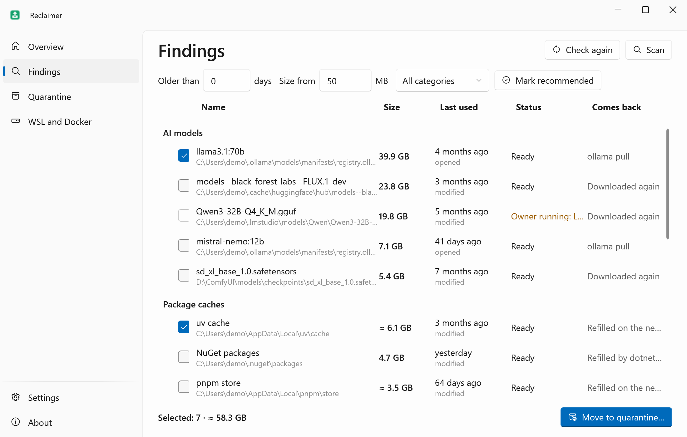
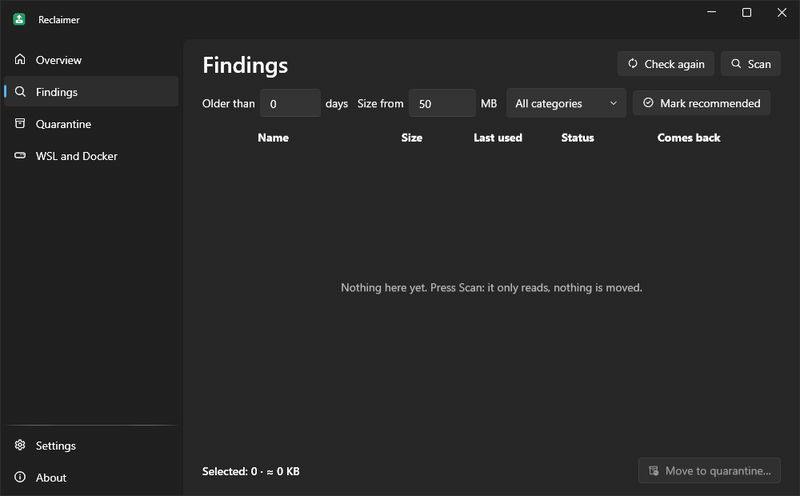
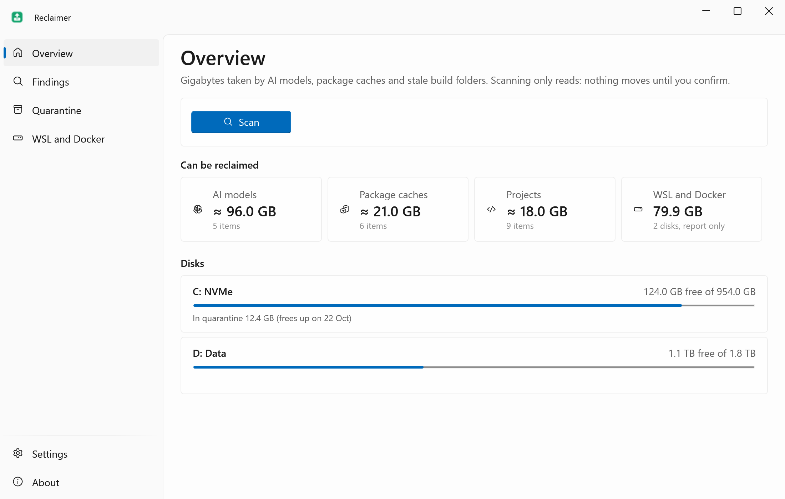
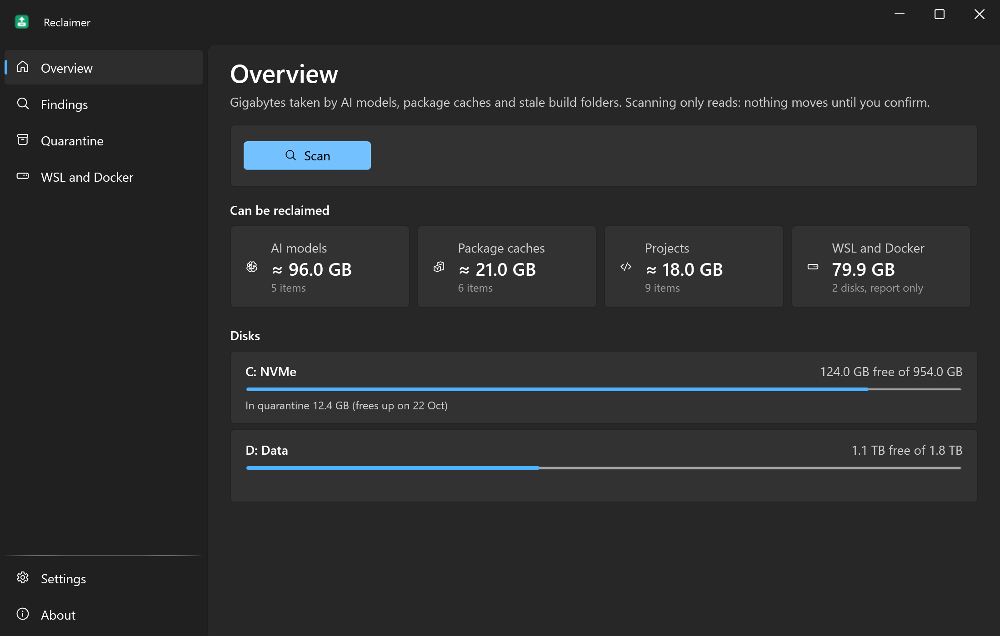
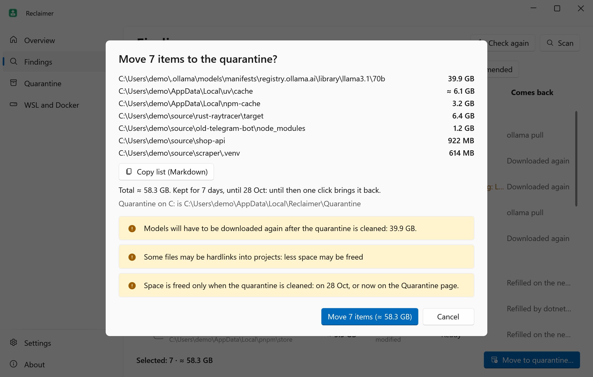
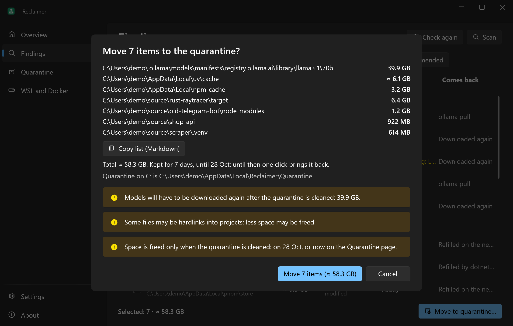
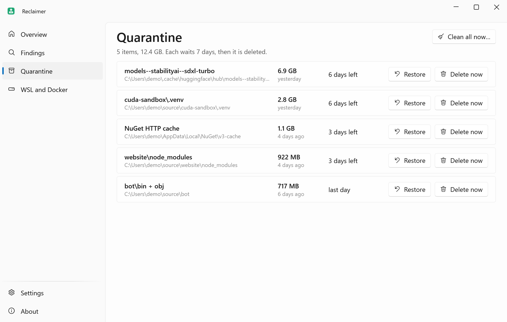
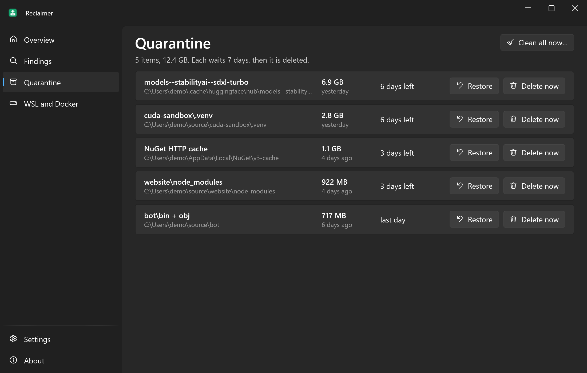
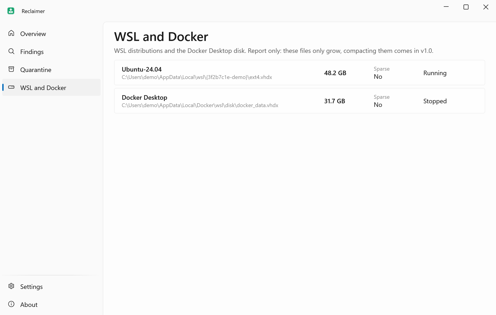
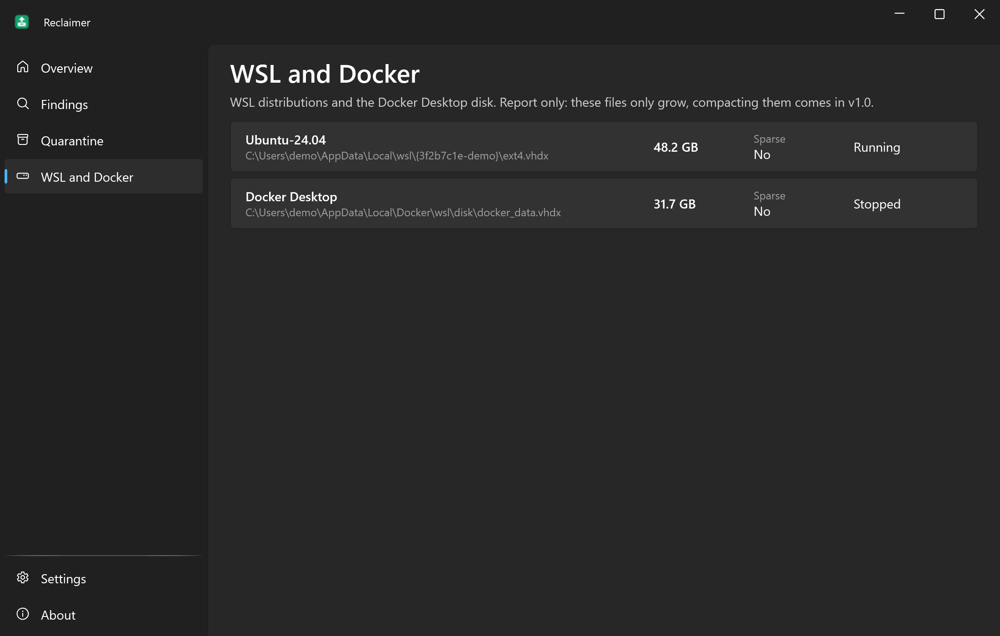

<div align="center">


# Reclaimer

**Get back tens of gigabytes from AI models, package caches and stale build folders, with a 7-day undo.**

**English** · [Русский](README.ru.md)

[](https://github.com/lojekq/Reclaimer/releases/latest)
[](https://github.com/lojekq/Reclaimer/releases)
[](https://github.com/lojekq/Reclaimer/actions/workflows/ci.yml)

[](LICENSE)

<picture>
  <source media="(prefers-color-scheme: dark)" srcset="docs/findings-dark-en.png">
  
</picture>
</div>

## Why

A year of local AI and side projects quietly eats a disk: a 40 GB model you tried once, a Hugging Face cache, `node_modules` and `target` in projects you forgot.
Generic cleaners don't know these places, and "biggest files" tools leave you guessing what is safe. Reclaimer knows them, says when each was last used, and nothing is deleted right away.

## Features

- **Knows the places** — Hugging Face, Ollama, LM Studio, ComfyUI, pip, uv, npm, pnpm, NuGet and Cargo, plus model folders you add.
- **Stale projects** — `node_modules`, `target`, `bin`/`obj`, `.venv`, `.next` in projects untouched for 90+ days, with the last commit date.
- **Honest "last used"** — and how it knows: last commit, modified, opened (only when NTFS records it), or "unknown".
- **7-day undo** — moved items wait in a quarantine on the same disk; one click brings them back.
- **Whitelist only** — it never touches anything outside known places and won't move models while Ollama or LM Studio is running.
- **WSL and Docker disks** — shows how big your `ext4.vhdx` and `docker_data.vhdx` really are (report only).

## See it in action



## Screenshots

| | Light | Dark |
|---|---|---|
| Overview |  |  |
| Confirmation |  |  |
| Quarantine |  |  |
| WSL and Docker |  |  |

## How it works

Reclaimer only looks where it knows what lives: the cache folders of each tool (their environment variables included) and build folders next to their marker: `node_modules` by `package.json`, `target` by `Cargo.toml`, `bin`+`obj` by a `.csproj` with `obj\project.assets.json`.
In a git repository a build folder is offered only if git says it is ignored. Scanning only reads; nothing changes until you confirm a list with every path and size.
An Ollama model is its manifest plus the layers no other model uses; a Hugging Face repo takes along the shared files only it links to.

"Moving to the quarantine" is a rename on the same disk, so it is instant and atomic: there is no copy that could stop half-way. A journal is written next to the data before the first rename.
The space comes back when the quarantine is cleaned: by itself after 7 days (1–30 in Settings), or now with **Delete now**.
"Last used" is the last commit for projects, otherwise the newest file date. NTFS can also record when a file was last opened; Reclaimer uses that only when it is turned on (`NtfsDisableLastAccessUpdate`). When it can't tell, it says "unknown".

## Download

1. Get **`Reclaimer-x.y.z-win-x64.exe`** from [Releases](https://github.com/lojekq/Reclaimer/releases/latest). Single file, no install, no admin.
2. Smaller build: `Reclaimer-x.y.z-win-x64-fd.zip` (needs [.NET Desktop Runtime 10](https://dotnet.microsoft.com/download/dotnet/10.0)).
3. Optional check: `gh attestation verify <file> -R lojekq/Reclaimer` or compare with `SHA256SUMS.txt`.

Requirements: Windows 11 x64. Windows 10 22H2 should work but is not tested.

## First run

Put the exe into `%LOCALAPPDATA%\Programs\Reclaimer\` first. From there it starts with Windows by default, because the quarantine is cleaned by the running app; from any other folder autostart stays off until you turn it on.
On the first start Windows may show a SmartScreen warning (see FAQ). Add your project folders on the Overview page, press **Scan**, tick what you don't need and press **Move to quarantine**. Models are never ticked for you.

## Settings

| Setting | Default | What it does |
|---|---|---|
| Project folders | none | Searched for build folders, up to 6 levels deep |
| Abandoned after | 90 days | What **Mark recommended** picks (models are never picked) |
| Keep in quarantine | 7 days | 1–30; then the item is deleted for good |
| Minimum size | 50 MB | Smaller findings are hidden |
| Model folders | none | ComfyUI `models`, GGUF folders: files of 100 MB and more |
| Own cache folders | none | Moved as a whole: only folders a tool refills by itself |
| Excluded folders | none | Never scanned or moved |
| Language, theme, Start with Windows, Start menu shortcut, check for updates | | As in every app of the set |

Settings, the action history (`history.jsonl`) and logs live in `%APPDATA%\Reclaimer`. The quarantine is `%LOCALAPPDATA%\Reclaimer\Quarantine` on the system disk and a hidden `.reclaimer-quarantine` folder on other disks.

## FAQ

<details><summary>Windows protected your PC / SmartScreen warning</summary>

The exe is not code-signed yet, so Windows does not know the publisher. Click **More info → Run anyway**.
Every file is built by GitHub Actions from this repository; you can check it with `gh attestation verify` or `SHA256SUMS.txt`.
Smart App Control, if it is on, blocks unsigned files with no way to allow one; the only option is to turn it off.
</details>

<details><summary>My antivirus flags it</summary>

Reclaimer renames and deletes folders, which heuristics watch for. It never deletes outside its quarantine, has no packer and no obfuscation; the code is all here.
Please report the false positive to your antivirus vendor and open an issue with the detection name and the SHA256 of the file.
</details>

<details><summary>Why didn't my free space grow after moving?</summary>

A rename keeps the data on the same disk, which is what makes the undo instant. The space is freed when the quarantine is cleaned: after the retention period, or now with **Delete now** or **Clean all now** on the Quarantine page.
For pnpm and uv some files may be hardlinks shared with projects, so the freed space can be smaller than shown; the number in the notification is measured on the disk.
</details>

<details><summary>A row says "Owner running" or "Files in use"</summary>

Reclaimer doesn't close programs. Close Ollama, LM Studio, the build or whatever holds the files, then press **Check again**. A row "Not in .gitignore" is a folder git tracks: it may hold your own files, so it can't be picked.
</details>

<details><summary>Controlled folder access blocked the move</summary>

Windows Security protects Documents, Desktop and other folders from programs it doesn't know. Nothing was changed. To allow it: Windows Security → Virus &amp; threat protection → Ransomware protection → Allow an app through Controlled folder access.
</details>

<details><summary>How do I uninstall?</summary>

First restore or clean the quarantine: **Remove data and autostart** refuses while it holds anything, since the journal would go with the data. Then About → **Remove data and autostart**, and delete the exe.
</details>

## Privacy

No telemetry. The only network request is the update check: `GET https://api.github.com/repos/lojekq/Reclaimer/releases/latest` once a day; turn it off in Settings.
It runs `git.exe` (with `core.fsmonitor=false`) to ask whether a folder is ignored and when the last commit was, and `wsl.exe --list --running`; both stay on this PC.
`history.jsonl` keeps the paths of what was moved, restored and deleted on this PC. Logs contain no paths.

## Build from source

```powershell
winget install Microsoft.DotNet.SDK.10
git clone https://github.com/lojekq/Reclaimer
cd Reclaimer
dotnet run --project src/Reclaimer
dotnet test
```

A Debug build only moves and deletes inside `C:\Demo\reclaimer-sandbox`; `pwsh tools/sandbox.ps1` creates it with placeholder files.

## License

MIT © 2026 lojekq
