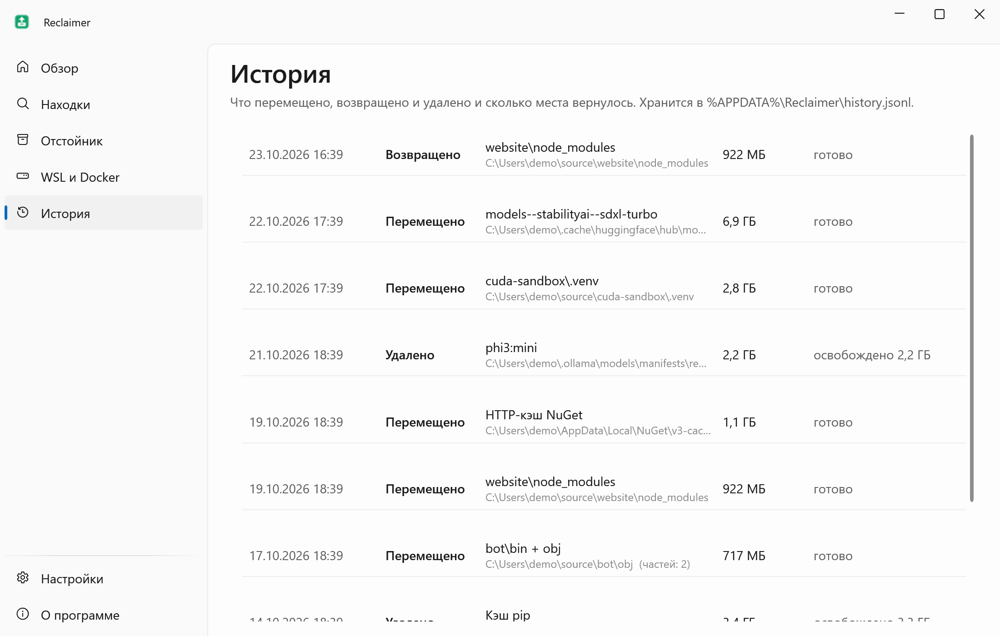
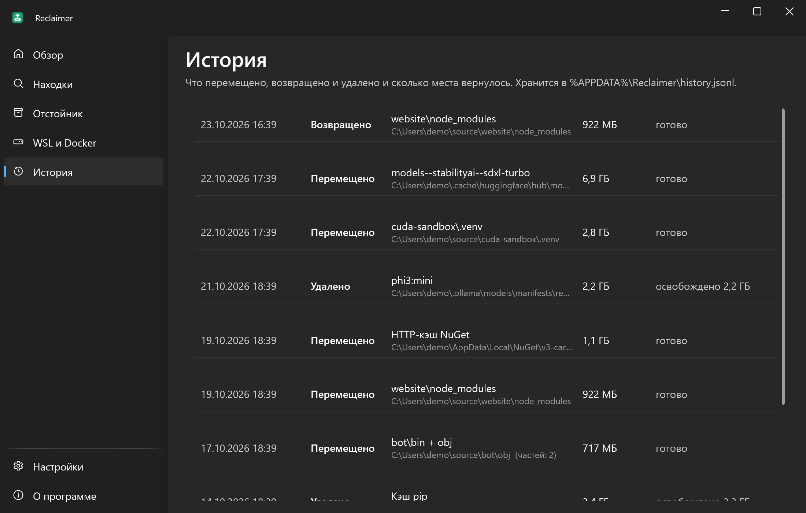

<div align="center">


# Reclaimer

**Возвращает десятки гигабайт из моделей ИИ, кэшей пакетов и старых папок сборки, и всё можно отменить в течение 7 дней.**

[English](README.md) · **Русский**

[](https://github.com/lojekq/Reclaimer/releases/latest)
[](https://github.com/lojekq/Reclaimer/releases)
[](https://github.com/lojekq/Reclaimer/actions/workflows/ci.yml)

[](LICENSE)

<picture>
  <source media="(prefers-color-scheme: dark)" srcset="docs/findings-dark-ru.png">
  
</picture>
</div>

## Зачем

Год с локальным ИИ и пет-проектами незаметно съедает диск: модель на 40 ГБ, которую запускали один раз, кэш Hugging Face, `node_modules` и `target` в забытых проектах.
Обычные чистильщики этих мест не знают, а программы «самые большие файлы» оставляют гадать, что можно удалить. Reclaimer знает, показывает, когда чем пользовались, и ничего не удаляет сразу.

## Возможности

- **Знает места** — Hugging Face (и старые ревизии, и недокачанное), Ollama, LM Studio, ComfyUI, llama.cpp, PyTorch hub, pip, uv, npm, pnpm, Yarn, NuGet, Cargo, Gradle, Maven и Go, плюс папки, которые ты добавишь. Любой `.gguf` или `.safetensors` от 1 ГБ в сканируемых папках тоже считается; тот, что держит запущенная программа или упоминает скрипт запуска, помечен «используется».
- **Заброшенные проекты** — `node_modules`, `target`, `bin`/`obj`, `.venv`, `.next` в проектах, которые не трогали 90+ дней, с датой последнего коммита.
- **Честное «последнее использование»** — и откуда оно известно: коммит, последний запуск в Ollama, изменён, открыт (только если NTFS это записывает) или «неизвестно».
- **Отмена 7 дней и история** — перемещённое ждёт в отстойнике на том же диске и возвращается одной кнопкой; в «Истории» каждое действие и освобождённое место, находки выгружаются в Markdown.
- **Только белый список** — ничего вне известных мест не трогает и не перемещает модели, пока запущены Ollama или LM Studio.
- **Одни веса дважды** — GGUF, который лежит и в Ollama, и в LM Studio, становится одним файлом с двумя именами (хардлинк), обе программы работают.
- **WSL и Docker** — сжимает `ext4.vhdx` и `docker_data.vhdx`, показывает `docker system df`, чистит кэш сборки и висячие образы.

## Как это выглядит


## Скриншоты

| | Светлая | Тёмная |
|---|---|---|
| Обзор |  |  |
| Подтверждение |  |  |
| Отстойник |  |  |
| WSL и Docker |  |  |
| История |  |  |

## Как это работает

Reclaimer смотрит только туда, где знает, что лежит: папки кэшей каждой программы (с учётом их переменных окружения) и папки сборки рядом с маркером: `node_modules` по `package.json`, `target` по `Cargo.toml`, `bin`+`obj` по `.csproj` с `obj\project.assets.json`.
В git-репозитории папку сборки можно выбрать, только если git говорит, что она игнорируется. Сканирование только читает; ничего не меняется, пока не подтвердишь список со всеми путями и размерами.
Модель Ollama — это манифест и слои, которыми не пользуется ни одна другая модель; репозиторий Hugging Face забирает с собой только те общие файлы, на которые ссылается он один.

«Переместить в отстойник» — это переименование на том же диске, поэтому оно мгновенное и атомарное: нет копирования, которое могло бы оборваться посередине. Журнал пишется рядом с данными до первого переименования.
Место возвращается при очистке отстойника: само через 7 дней (1–30 в настройках) или сразу кнопкой **Удалить сейчас**.
«Последнее использование» — это последний коммит для проектов, иначе самая свежая дата файла. NTFS умеет записывать и время последнего открытия файла; Reclaimer берёт его, только если это включено (`NtfsDisableLastAccessUpdate`). Когда узнать нельзя, честно стоит «неизвестно».

## Скачать

1. **[Скачать Reclaimer.exe](https://github.com/lojekq/Reclaimer/releases/latest/download/Reclaimer.exe)** (последний релиз). Один файл, без прав администратора.
2. Сборка поменьше: [`Reclaimer-fd.zip`](https://github.com/lojekq/Reclaimer/releases/latest/download/Reclaimer-fd.zip) (нужен [.NET Desktop Runtime 10](https://dotnet.microsoft.com/download/dotnet/10.0)).
3. Проверка по желанию: `gh attestation verify <файл> -R lojekq/Reclaimer` или сверка с `SHA256SUMS.txt`.

Требования: Windows 11 x64. Windows 10 22H2 должна работать, но не тестируется.

## Первый запуск

Запусти скачанный exe откуда угодно. Сначала Windows может показать предупреждение SmartScreen (см. «Вопросы»).
Reclaimer предложит установиться: **«Установить»** копирует его в `%LOCALAPPDATA%\Programs\Reclaimer\`, добавляет ярлык в «Пуске», запись в «Параметры → Приложения» и автозапуск (отстойник очищает работающая программа); права администратора не нужны.
**«Без установки»** оставляет его портативным, без автозапуска. Обновление: запусти новый exe так же, он заменит установленный и перезапустит его.
Затем добавь папки проектов на странице «Обзор», нажми **Сканировать**, отметь ненужное и нажми **Переместить в отстойник**. Модели сами не отмечаются никогда.

## Настройки

| Настройка | По умолчанию | Что делает |
|---|---|---|
| Папки проектов | нет | В них ищутся папки сборки, до 6 уровней вглубь |
| Заброшено через | 90 дней | Что выбирает **Отметить рекомендуемое** (модели не выбираются) |
| Хранить в отстойнике | 7 дней | 1–30; потом объект удаляется насовсем |
| Минимальный размер | 50 МБ | Находки меньше скрыты |
| Папки моделей | нет | `models` ComfyUI, папки GGUF: файлы от 100 МБ |
| Свои папки кэша | нет | Переносятся целиком: только то, что программа наполнит сама |
| Исключённые папки | нет | Никогда не сканируются и не перемещаются |
| Папки скриптов запуска | нет | Скрипты и конфиги, которые запускают твои модели; упомянутая в них модель «используется» и не выбирается |
| Еженедельное напоминание | выкл. | Раз в неделю тихое сканирование сообщает, сколько можно вернуть, если это 1 ГБ и больше |
| Запускать вместе с Windows | вкл. после установки | Нужно для автоочистки отстойника |
| Установка | — | «Установить», а у установленной — «Удалить» |
| Язык, тема, ярлык в «Пуске», проверка обновлений | | Как во всех программах набора |

Настройки, история действий (`history.jsonl`) и логи лежат в `%APPDATA%\Reclaimer`. Отстойник — `%LOCALAPPDATA%\Reclaimer\Quarantine` на системном диске и скрытая папка `.reclaimer-quarantine` на остальных.

## Вопросы

<details><summary>«Система Windows защитила ваш компьютер» / SmartScreen</summary>

У exe пока нет цифровой подписи, поэтому Windows не знает издателя. Нажми **Подробнее → Выполнить в любом случае**.
Каждый файл собирает GitHub Actions из этого репозитория; проверить можно через `gh attestation verify` или `SHA256SUMS.txt`.
Smart App Control, если включён, блокирует неподписанные файлы без возможности разрешить один; остаётся только выключить его.
</details>

<details><summary>Антивирус ругается</summary>

Reclaimer переименовывает и удаляет папки, и эвристики за этим следят. Вне своего отстойника он ничего не удаляет, упаковщиков и обфускации нет, устанавливается только в папку пользователя; весь код здесь.
Сообщи о ложном срабатывании производителю антивируса и открой issue с названием детекта и SHA256 файла.
</details>

<details><summary>Почему после перемещения свободного места не прибавилось?</summary>

Переименование оставляет данные на том же диске, поэтому отмена мгновенная. Место освобождается при очистке отстойника: после срока хранения или сразу кнопкой **Удалить сейчас** / **Очистить всё сейчас** на странице «Отстойник».
У pnpm и uv часть файлов может быть хардлинками в проекты, поэтому освободится меньше показанного; число в уведомлении измерено на диске.
</details>

<details><summary>В строке «Запущен владелец», «Используется» или «Файлы заняты»</summary>

Reclaimer не закрывает программы. Закрой Ollama, LM Studio, сборку или то, что держит файлы, и нажми **Проверить снова**.
«Используется» — модель из твоих папок, которую держит запущенная программа (llama-server с `-m`, ComfyUI, LM Studio) или упоминает скрипт запуска; скрипты MLink читаются сами, другие папки скриптов добавь в настройках. Имя или путь строки копируются из меню по правой кнопке (Ctrl+C копирует имя). «Не в .gitignore» — папку отслеживает git: в ней могут быть твои файлы, поэтому выбрать её нельзя.
</details>

<details><summary>Как сжимается диск WSL или Docker?</summary>

Эти диски растут, но сами не уменьшаются. **Сжать…** по желанию выполняет `fstrim` внутри дистрибутива, просит выйти из Docker Desktop, останавливает WSL (`wsl --shutdown` останавливает все дистрибутивы, поэтому сначала спрашивает), затем Windows запрашивает права администратора для `diskpart`: диск подключается только для чтения, сжимается и отключается.
От администратора работает только этот шаг, в отдельном процессе `Reclaimer.exe --compact-vhdx`, который принимает только диск, найденный самим Reclaimer. Внутри диска ничего не удаляется.
</details>

<details><summary>Дубли: а если программа изменит файл?</summary>

Остаётся копия в Ollama или Hugging Face: они не правят блобы на месте. Если другая программа изменила бы такой файл на месте, изменение увидели бы обе, и окно подтверждения об этом предупреждает. **Вернуть** снимает хардлинк и возвращает отдельную копию.
</details>

<details><summary>Кнопки Docker</summary>

`docker builder prune -f` и `docker image prune -f` (только висячие образы) удаляют насовсем, без отстойника; это написано и на кнопках, и в подтверждении. Тома (volumes) и `system prune -a` не трогаются никогда.
</details>

<details><summary>Контролируемый доступ к папкам заблокировал перемещение</summary>

Безопасность Windows защищает «Документы», «Рабочий стол» и другие папки от незнакомых программ. Ничего не изменилось. Чтобы разрешить: Безопасность Windows → Защита от вирусов и угроз → Защита от программ-шантажистов → Разрешить работу приложения через контролируемый доступ к папкам.
</details>

<details><summary>Как удалить программу?</summary>

Сначала верни или очисти отстойник: удаление отказывается, пока в нём что-то есть, иначе перемещённое и его журнал остались бы брошенными или пропали.
Затем «Настройки» → **«Удалить»** или «Параметры Windows» → «Приложения» → Reclaimer → «Удалить». Настройки, история и логи удаляются по твоему выбору.
Без установки: «О программе» → **«Удалить данные и автозапуск»** и удали exe.
</details>

## Приватность

Без телеметрии. Единственный сетевой запрос — проверка обновлений: `GET https://api.github.com/repos/lojekq/Reclaimer/releases/latest` раз в сутки, выключается в настройках.
Запускает `git.exe` (с `core.fsmonitor=false`), чтобы узнать, игнорируется ли папка и когда был последний коммит, `wsl.exe --list --running` и `docker system df`; по твоей команде ещё очистку Docker, `fstrim`, `wsl --shutdown` и `diskpart`. Всё остаётся на этом ПК.
Читает `server*.log` Ollama, чтобы знать, когда модель запускалась в последний раз, и скрипты запуска в папке MLink и в добавленных папках скриптов (только текст, чтобы узнать, какие модели они запускают).
`history.jsonl` хранит на этом ПК пути того, что перемещено, возвращено и удалено. В логах путей нет.

## Сборка из исходников

```powershell
winget install Microsoft.DotNet.SDK.10
git clone https://github.com/lojekq/Reclaimer
cd Reclaimer
dotnet run --project src/Reclaimer
dotnet test
```

Debug-сборка перемещает и удаляет только внутри `C:\Demo\reclaimer-sandbox`; `pwsh tools/sandbox.ps1` создаёт её из файлов-пустышек.

## Лицензия

MIT © 2026 lojekq
