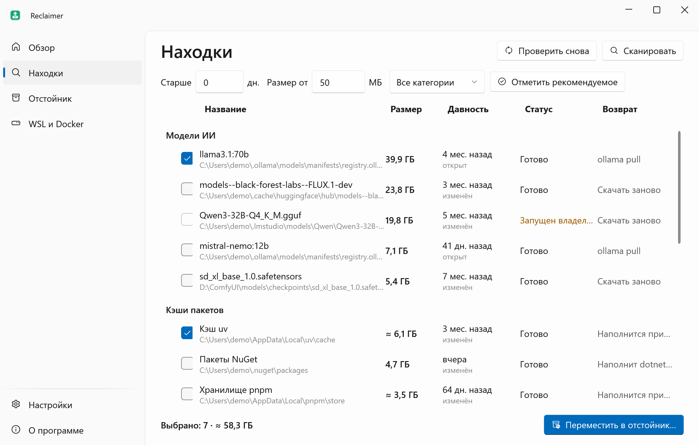
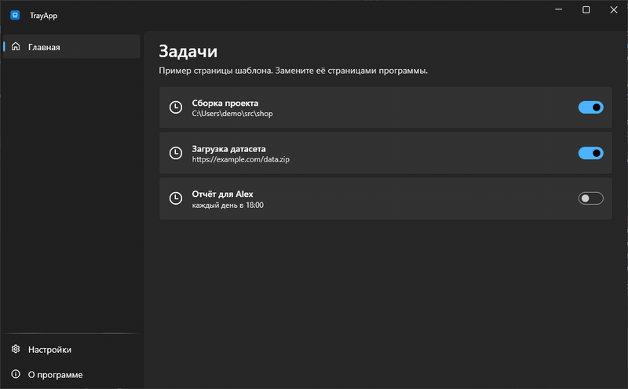
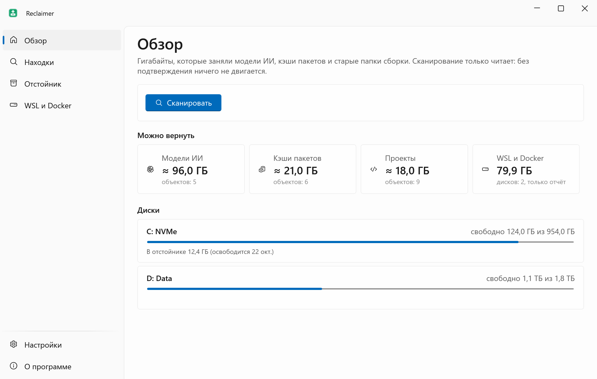
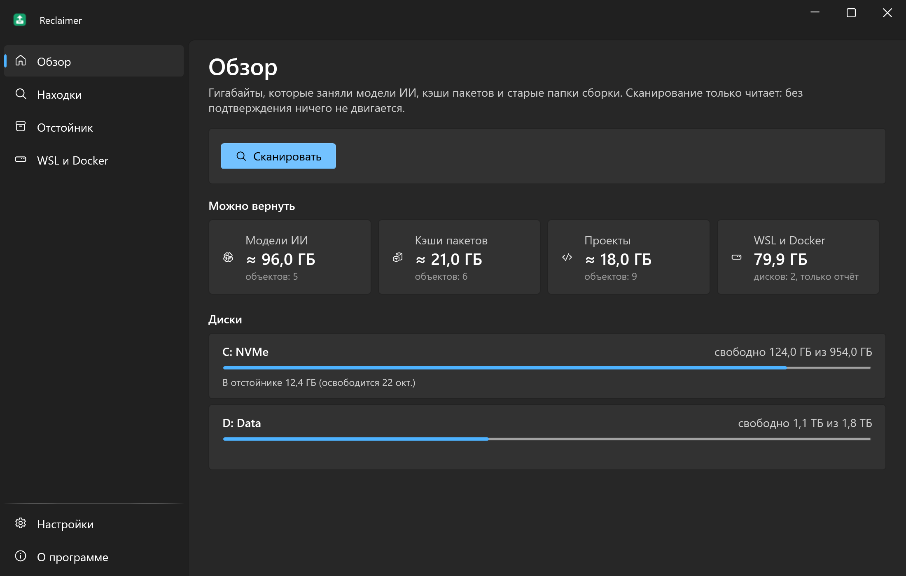
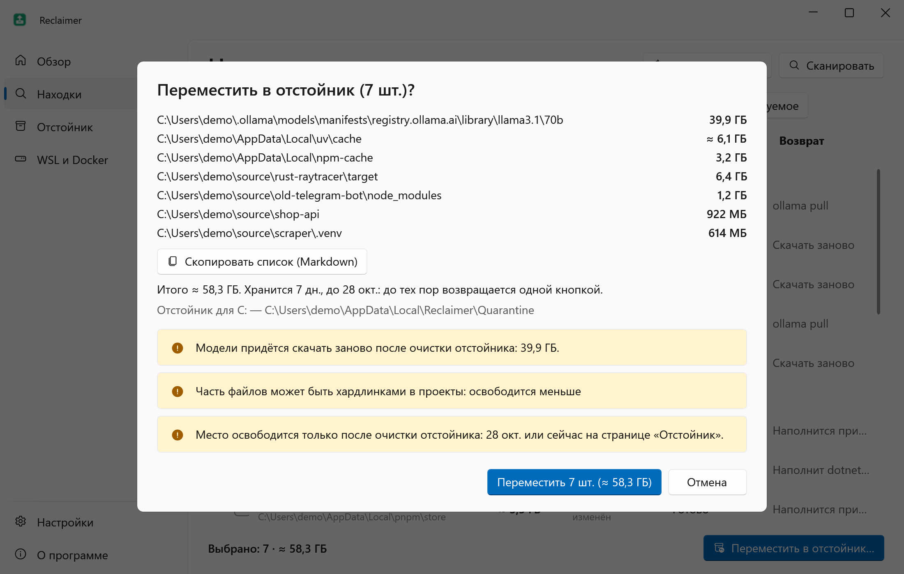
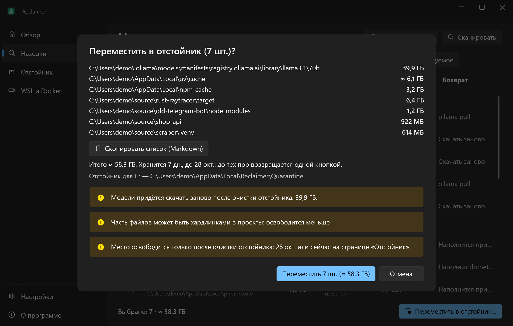
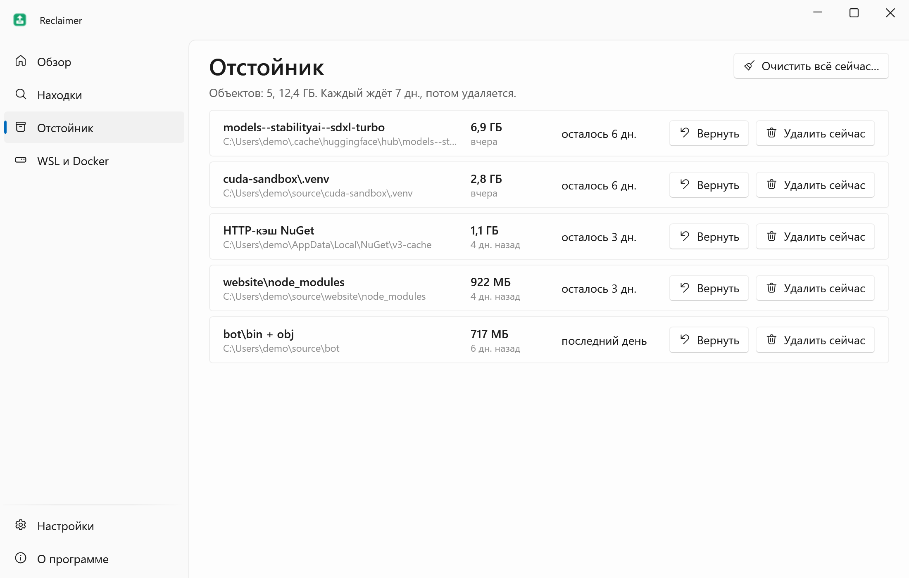
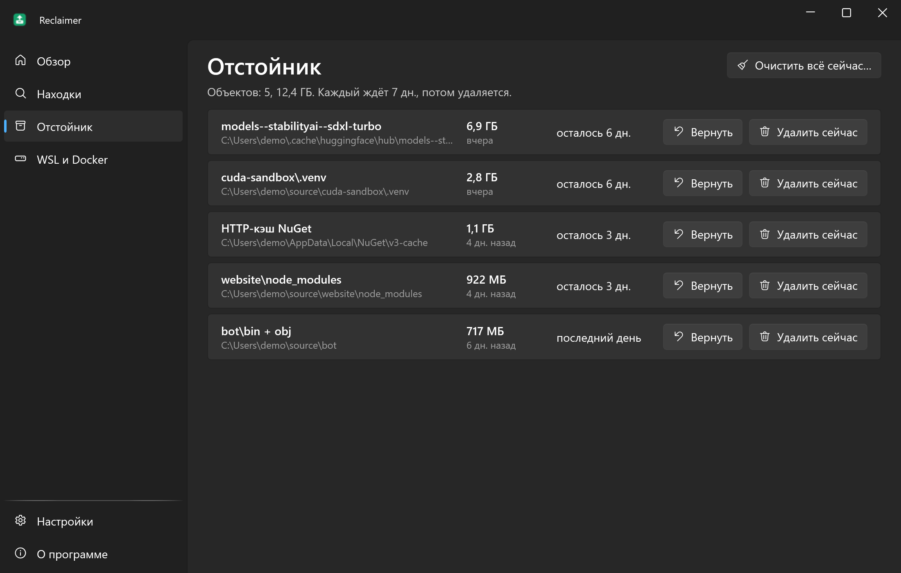
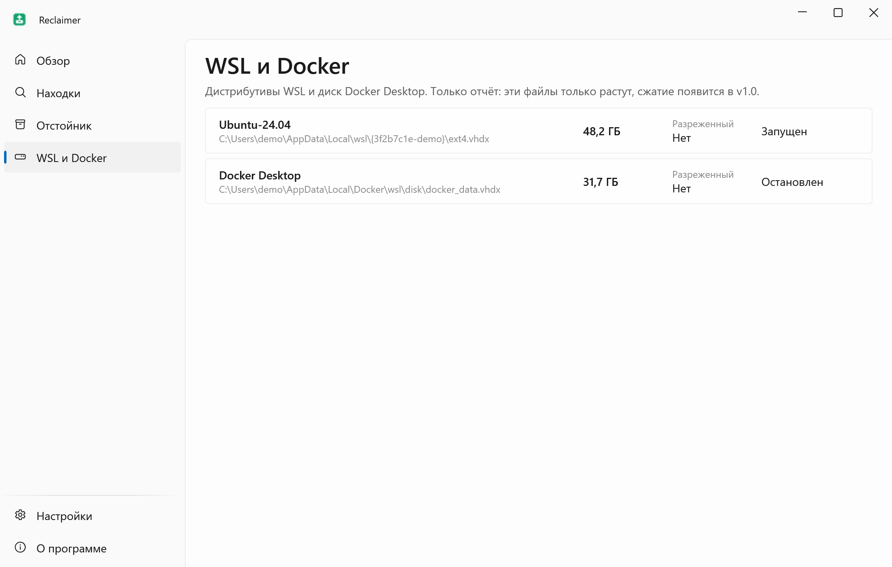
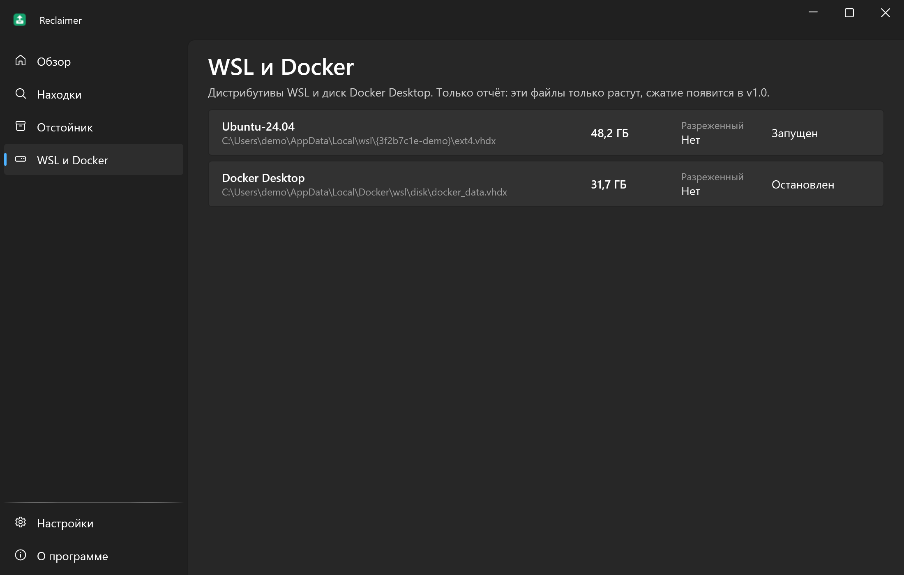

<div align="center">


# Reclaimer

**Возвращает десятки гигабайт из моделей ИИ, кэшей пакетов и старых папок сборки, и всё можно отменить в течение 7 дней.**

[English](README.md) · **Русский**

[](https://github.com/lojekq/Reclaimer/releases/latest)
[](https://github.com/lojekq/Reclaimer/releases)
[](https://github.com/lojekq/Reclaimer/actions/workflows/ci.yml)

[](LICENSE)

<picture>
  <source media="(prefers-color-scheme: dark)" srcset="docs/findings-dark-ru.png">
  
</picture>
</div>

## Зачем

Год с локальным ИИ и пет-проектами незаметно съедает диск: модель на 40 ГБ, которую запускали один раз, кэш Hugging Face, `node_modules` и `target` в забытых проектах.
Обычные чистильщики этих мест не знают, а программы «самые большие файлы» оставляют гадать, что можно удалить. Reclaimer знает, показывает, когда чем пользовались, и ничего не удаляет сразу.

## Возможности

- **Знает места** — Hugging Face, Ollama, LM Studio, ComfyUI, pip, uv, npm, pnpm, NuGet и Cargo, плюс папки моделей, которые ты добавишь.
- **Заброшенные проекты** — `node_modules`, `target`, `bin`/`obj`, `.venv`, `.next` в проектах, которые не трогали 90+ дней, с датой последнего коммита.
- **Честное «последнее использование»** — и откуда оно известно: коммит, изменён, открыт (только если NTFS это записывает) или «неизвестно».
- **Отмена 7 дней** — перемещённое ждёт в отстойнике на том же диске; вернуть можно одной кнопкой.
- **Только белый список** — ничего вне известных мест не трогает и не перемещает модели, пока запущены Ollama или LM Studio.
- **Диски WSL и Docker** — показывает реальный размер `ext4.vhdx` и `docker_data.vhdx` (только отчёт).

## Как это выглядит



## Скриншоты

| | Светлая | Тёмная |
|---|---|---|
| Обзор |  |  |
| Подтверждение |  |  |
| Отстойник |  |  |
| WSL и Docker |  |  |

## Как это работает

Reclaimer смотрит только туда, где знает, что лежит: папки кэшей каждой программы (с учётом их переменных окружения) и папки сборки рядом с маркером: `node_modules` по `package.json`, `target` по `Cargo.toml`, `bin`+`obj` по `.csproj` с `obj\project.assets.json`.
В git-репозитории папку сборки можно выбрать, только если git говорит, что она игнорируется. Сканирование только читает; ничего не меняется, пока не подтвердишь список со всеми путями и размерами.
Модель Ollama — это манифест и слои, которыми не пользуется ни одна другая модель; репозиторий Hugging Face забирает с собой только те общие файлы, на которые ссылается он один.

«Переместить в отстойник» — это переименование на том же диске, поэтому оно мгновенное и атомарное: нет копирования, которое могло бы оборваться посередине. Журнал пишется рядом с данными до первого переименования.
Место возвращается при очистке отстойника: само через 7 дней (1–30 в настройках) или сразу кнопкой **Удалить сейчас**.
«Последнее использование» — это последний коммит для проектов, иначе самая свежая дата файла. NTFS умеет записывать и время последнего открытия файла; Reclaimer берёт его, только если это включено (`NtfsDisableLastAccessUpdate`). Когда узнать нельзя, честно стоит «неизвестно».

## Скачать

1. Скачай **`Reclaimer-x.y.z-win-x64.exe`** из [Releases](https://github.com/lojekq/Reclaimer/releases/latest). Один файл, без установки и без прав администратора.
2. Сборка поменьше: `Reclaimer-x.y.z-win-x64-fd.zip` (нужен [.NET Desktop Runtime 10](https://dotnet.microsoft.com/download/dotnet/10.0)).
3. Проверка по желанию: `gh attestation verify <файл> -R lojekq/Reclaimer` или сверка с `SHA256SUMS.txt`.

Требования: Windows 11 x64. Windows 10 22H2 должна работать, но не тестируется.

## Первый запуск

Сначала положи exe в `%LOCALAPPDATA%\Programs\Reclaimer\`. Оттуда он по умолчанию запускается вместе с Windows: отстойник очищает работающая программа. Из любой другой папки автозапуск выключен, пока не включишь его сам.
При первом запуске Windows может показать предупреждение SmartScreen (см. «Вопросы»). Добавь папки проектов на странице «Обзор», нажми **Сканировать**, отметь ненужное и нажми **Переместить в отстойник**. Модели сами не отмечаются никогда.

## Настройки

| Настройка | По умолчанию | Что делает |
|---|---|---|
| Папки проектов | нет | В них ищутся папки сборки, до 6 уровней вглубь |
| Заброшено через | 90 дней | Что выбирает **Отметить рекомендуемое** (модели не выбираются) |
| Хранить в отстойнике | 7 дней | 1–30; потом объект удаляется насовсем |
| Минимальный размер | 50 МБ | Находки меньше скрыты |
| Папки моделей | нет | `models` ComfyUI, папки GGUF: файлы от 100 МБ |
| Свои папки кэша | нет | Переносятся целиком: только то, что программа наполнит сама |
| Исключённые папки | нет | Никогда не сканируются и не перемещаются |
| Язык, тема, автозапуск, ярлык в «Пуске», проверка обновлений | | Как во всех программах набора |

Настройки, история действий (`history.jsonl`) и логи лежат в `%APPDATA%\Reclaimer`. Отстойник — `%LOCALAPPDATA%\Reclaimer\Quarantine` на системном диске и скрытая папка `.reclaimer-quarantine` на остальных.

## Вопросы

<details><summary>«Система Windows защитила ваш компьютер» / SmartScreen</summary>

У exe пока нет цифровой подписи, поэтому Windows не знает издателя. Нажми **Подробнее → Выполнить в любом случае**.
Каждый файл собирает GitHub Actions из этого репозитория; проверить можно через `gh attestation verify` или `SHA256SUMS.txt`.
Smart App Control, если включён, блокирует неподписанные файлы без возможности разрешить один; остаётся только выключить его.
</details>

<details><summary>Антивирус ругается</summary>

Reclaimer переименовывает и удаляет папки, и эвристики за этим следят. Вне своего отстойника он ничего не удаляет, упаковщиков и обфускации нет, весь код здесь.
Сообщи о ложном срабатывании производителю антивируса и открой issue с названием детекта и SHA256 файла.
</details>

<details><summary>Почему после перемещения свободного места не прибавилось?</summary>

Переименование оставляет данные на том же диске, поэтому отмена мгновенная. Место освобождается при очистке отстойника: после срока хранения или сразу кнопкой **Удалить сейчас** / **Очистить всё сейчас** на странице «Отстойник».
У pnpm и uv часть файлов может быть хардлинками в проекты, поэтому освободится меньше показанного; число в уведомлении измерено на диске.
</details>

<details><summary>В строке «Запущен владелец» или «Файлы заняты»</summary>

Reclaimer не закрывает программы. Закрой Ollama, LM Studio, сборку или то, что держит файлы, и нажми **Проверить снова**. «Не в .gitignore» — папку отслеживает git: в ней могут быть твои файлы, поэтому выбрать её нельзя.
</details>

<details><summary>Контролируемый доступ к папкам заблокировал перемещение</summary>

Безопасность Windows защищает «Документы», «Рабочий стол» и другие папки от незнакомых программ. Ничего не изменилось. Чтобы разрешить: Безопасность Windows → Защита от вирусов и угроз → Защита от программ-шантажистов → Разрешить работу приложения через контролируемый доступ к папкам.
</details>

<details><summary>Как удалить программу?</summary>

Сначала верни или очисти отстойник: **Удалить данные и автозапуск** отказывается, пока в нём что-то есть, иначе журнал удалился бы вместе с данными. Затем «О программе» → **Удалить данные и автозапуск** и удали exe.
</details>

## Приватность

Без телеметрии. Единственный сетевой запрос — проверка обновлений: `GET https://api.github.com/repos/lojekq/Reclaimer/releases/latest` раз в сутки, выключается в настройках.
Запускает `git.exe` (с `core.fsmonitor=false`), чтобы узнать, игнорируется ли папка и когда был последний коммит, и `wsl.exe --list --running`; всё остаётся на этом ПК.
`history.jsonl` хранит на этом ПК пути того, что перемещено, возвращено и удалено. В логах путей нет.

## Сборка из исходников

```powershell
winget install Microsoft.DotNet.SDK.10
git clone https://github.com/lojekq/Reclaimer
cd Reclaimer
dotnet run --project src/Reclaimer
dotnet test
```

Debug-сборка перемещает и удаляет только внутри `C:\Demo\reclaimer-sandbox`; `pwsh tools/sandbox.ps1` создаёт её из файлов-пустышек.

## Лицензия

MIT © 2026 lojekq
